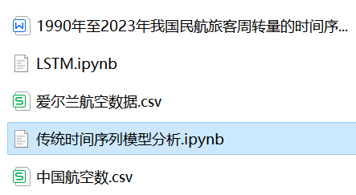
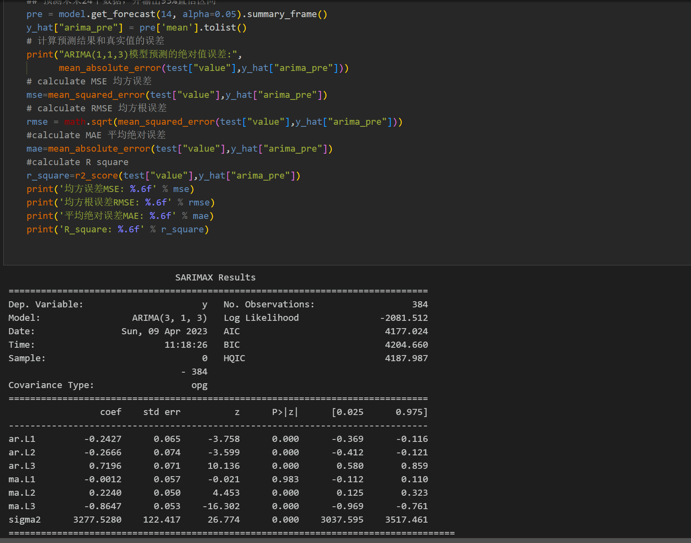
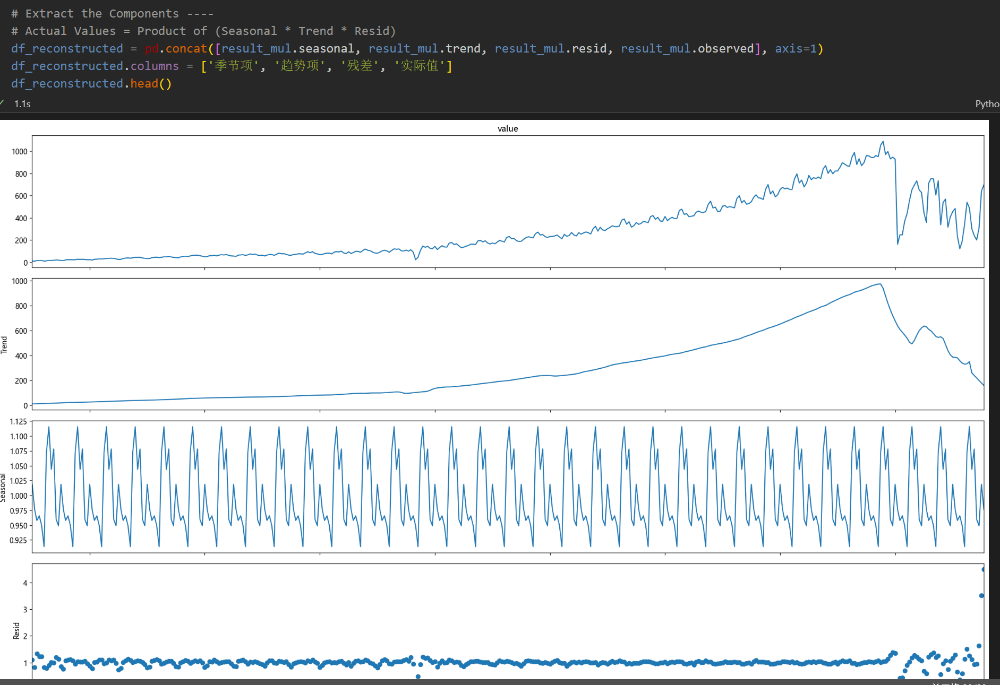
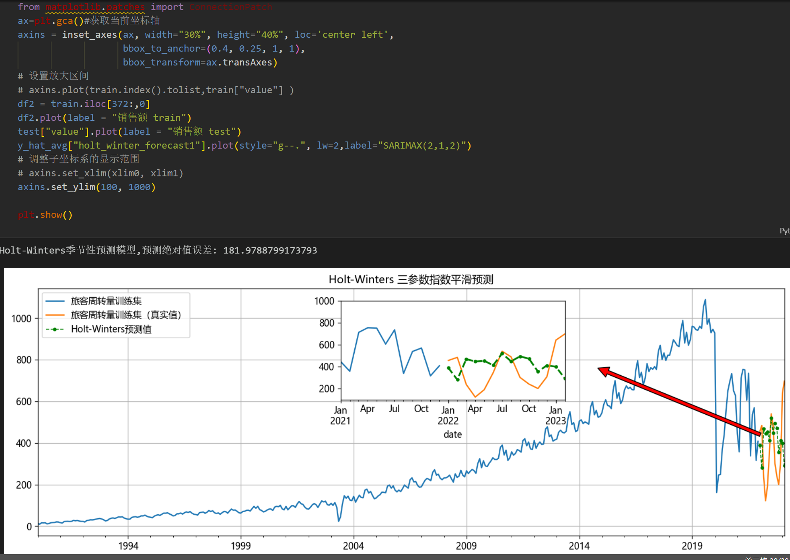
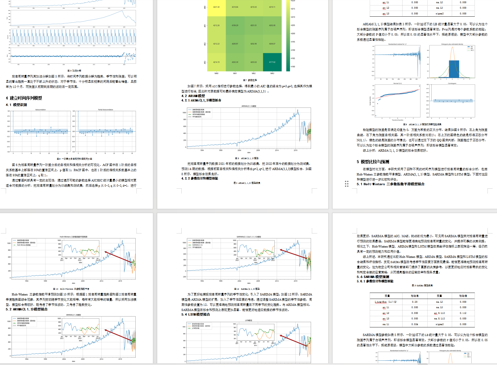

# Analysis and comparison of LSTM, ARIMA, Holt-Winters, SARIMA models based on Python time series prediction

Single-variable includes the following content:
Time series prediction analysis based on Python, and all code in this report can be run.
Environment: python3.9
\n        \n      \n        \n  
\n        \n  
\n        \n      \n        \n

## Images

<!-- PAYMENT_BLOCK -->

## Get this dataset

- Payment link (Stripe): [Buy now](https://buy.stripe.com/3cs8yP7sY87d0vu9AB)
- Payment QR code: 

<!-- /PAYMENT_BLOCK -->
